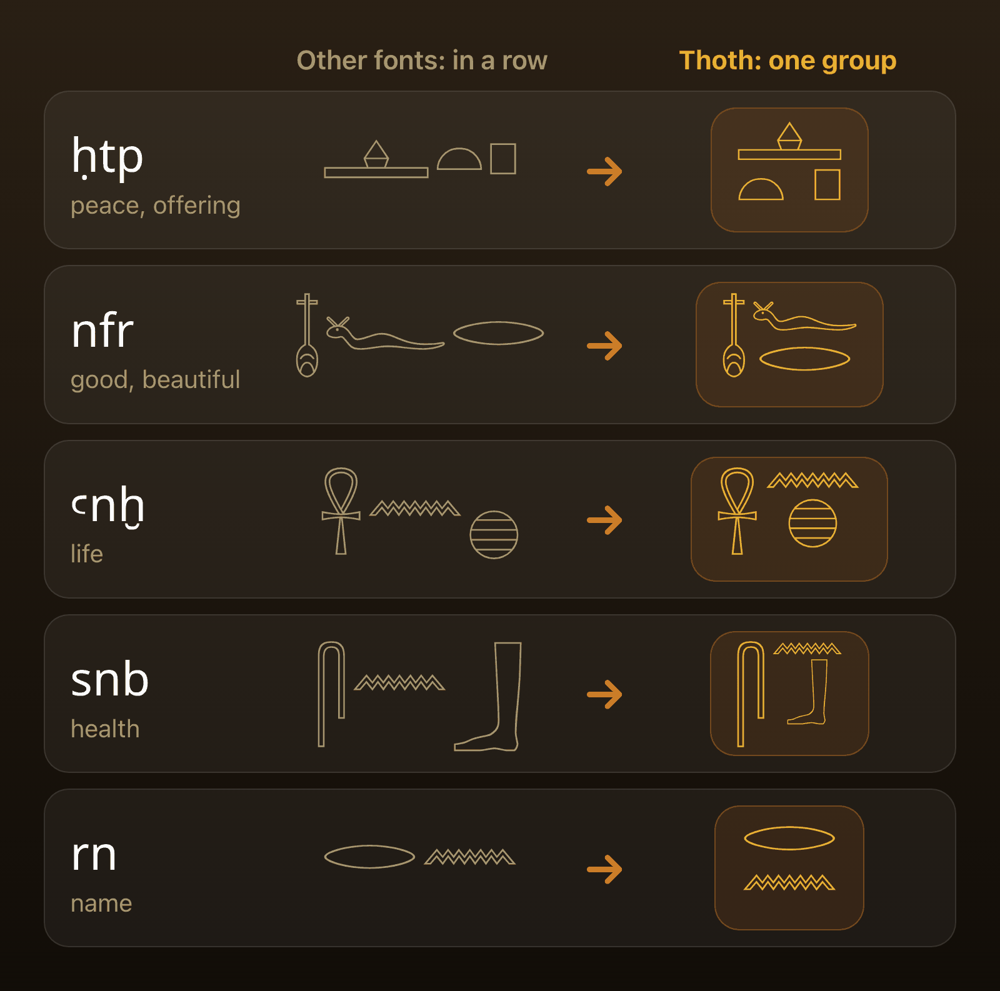

# Thoth

**Thoth** is an open-source Egyptian hieroglyph font from the [Bastet](https://github.com/bastet00) project that stacks and groups signs into quadrats.



It is named after Thoth (Egyptian *ḏḥwtj*, Djehuty; Arabic تحوت), the god who in Egyptian belief gave people the hieroglyphic script.

Status: **work in progress** – the font builds and contains the signs, imported from Noto Sans Egyptian Hieroglyphs, and the Latin letters for Egyptological transliteration (ꜣ ꜥ ḥ ḫ ẖ š ṯ ḏ and the rest), taken from Noto Sans (see [Credits](#credits)). It draws groups with Unicode's Egyptian hieroglyph format controls: the joiners, insertions, overlay, one level of nested groups, enclosures such as the cartouche, mirrored signs and damage shading (see the table below). Common groups also stack in plain text without any control (see below). Right-to-left runs are not supported yet.

The font also contains the first few signs of Egyptian Hieroglyphs Extended-A (Unicode 16), drawn by the Thoth project in the style of the existing signs: U+135AC, U+1360A, U+1360C, U+138FC and U+13910. They are signs like all others: they stack, take insertions where their shape leaves room, go into enclosures, and can be mirrored and damaged.

## What the font does

Unicode encodes hieroglyph layout with format controls (U+13430–U+13455). The font contains the OpenType rules that turn them into a quadrat:

| Control | Code point | Meaning |
|---|---|---|
| Vertical joiner | U+13430 | next sign goes under this one |
| Horizontal joiner | U+13431 | signs side by side inside a group |
| Insert at corners | U+13432–U+13435 | small sign tucked into a corner |
| Overlay middle | U+13436 | two signs drawn across each other |
| Begin / end segment | U+13437 / U+13438 | a group inside a group (one level) |
| Insert at middle, top, bottom | U+13439–U+1343B | small sign placed inside or centred on a sign |
| Begin / end enclosure | U+1343C–U+1343F | a cartouche, ḥwt or wall drawn around any number of groups |
| Mirror horizontally | U+13440 | the sign before it faces the other way |
| Damage modifiers | U+13447–U+13455 | shading over the damaged quarters of the sign before it |

Input the font cannot draw (a control in the wrong place, nesting deeper than one level, a mirrored sign in the smallest group sizes) shows its signs with a dashed box, never hidden text.

Example: `𓂋` U+13430 `𓈖` renders as 𓂋 above 𓈖 in one group.

### Automatic stacking

Almost no text contains these controls, so Thoth also stacks the words of its own word list when they are typed as plain signs: `𓂋𓈖` comes out as 𓂋 above 𓈖 without anything typed between them. The list (`scripts/stack/automatic.txt`, 90 words; see its header) is the project's own: the words of the Bastet course (units 1 and 2), the project's test words, and the owner's bird-corner words, each in its standard spelling. For a word in the list the font adds the same controls a writer would type, so the result looks exactly as with the controls. Outside the list one rule goes by shape alone: two half-block signs in a row (at most half the quadrat high and at least half of it wide, such as 𓊃 and 𓆑) stack one above the other, two by two, unless the run follows a lower sign that may stand above it (`scripts/stack/layout.py`, rules A7 to A9). Everything else keeps its signs in a row rather than risk a wrong stack: type the controls to stack it.

- Explicit controls always win: a sign right after a control starts no automatic block, and an automatic block never reaches a control; a word of the list wins over the shape rule.
- To keep two signs apart, put a space or ZWNJ (U+200C) between them.
- To switch the automatic layer off, turn off the OpenType feature `calt` (CSS `font-feature-settings: "calt" 0`; HarfBuzz `-calt`). The controls keep working.

## Where it will be used

- **bastet-app** (Flutter, Android + iOS): bundled in `assets/fonts/`, so every user gets it with an app update. Flutter shapes text itself, so it does not depend on fonts installed on the phone.
- **bastet-website**: loaded with `@font-face`, so every visitor gets it.
- **simple-keyboard-hiero** (Android): can show stacked groups on the keys. Text typed into other apps still uses that app's own font.

## Building

This repository follows the [Google Fonts project template](https://github.com/googlefonts/googlefonts-project-template), so it can later be submitted to Google Fonts.

```bash
make build   # builds into fonts/ (runs sources/build.sh inside the virtual environment)
make test    # runs the shaping test, then fontspector with the Google Fonts profile
make proof   # HTML proofs in out/proof
```

The only hand-edited font source is `sources/Thoth-Regular.ufo`. `sources/build.sh` is the one build command, in two steps:

1. The generator in `scripts/stack` reads the source and writes the font that gets compiled to `sources/build/` (not committed): `layout.py` decides where every sign of a group goes, `glyphs.py` adds a scaled copy of each sign per size level and the empty marker glyphs, and `features.py` writes the OpenType rules (GSUB `calt` for the automatic layer and `rlig`, GPOS `mark`/`mkmk`) that compute the same layout while the text is shaped.
2. `gftools builder` compiles it as set up in `sources/config.yaml`, and adds the Latin letters from a tagged Noto Sans release, which it downloads on the first build.

`tests/test_layout.py` checks the layout rules; `tests/test_shaping.py` shapes text with HarfBuzz and checks that the font draws every group exactly as `layout.py` says. The font is a static TTF and stays unhinted (the size levels are scaled components). Built fonts are not committed; GitHub Actions builds them, and tagged releases (e.g. `0.100`) get a zip attached.

## Road to Google Fonts

1. Write the quadrat rules (flat groups done).
2. Get `make build` and `make test` passing in CI.
3. Make the repository public and tag a release.
4. Open an "Add font" issue at [google/fonts](https://github.com/google/fonts/issues).

## Credits

The sign outlines of the Egyptian Hieroglyphs block come from [Noto Sans Egyptian Hieroglyphs](https://github.com/notofonts/egyptian-hieroglyphs), designed by the Monotype Design Team for the Noto project and published under the SIL Open Font License (imported at commit `209775d`). The Latin letters, combining marks and brackets for transliteration come from [Noto Sans](https://github.com/notofonts/latin-greek-cyrillic) (release `NotoSans-v2.015`), also under the SIL Open Font License. Both copyright notices are kept in `OFL.txt` and in the font.

## License

[SIL Open Font License 1.1](OFL.txt). 
